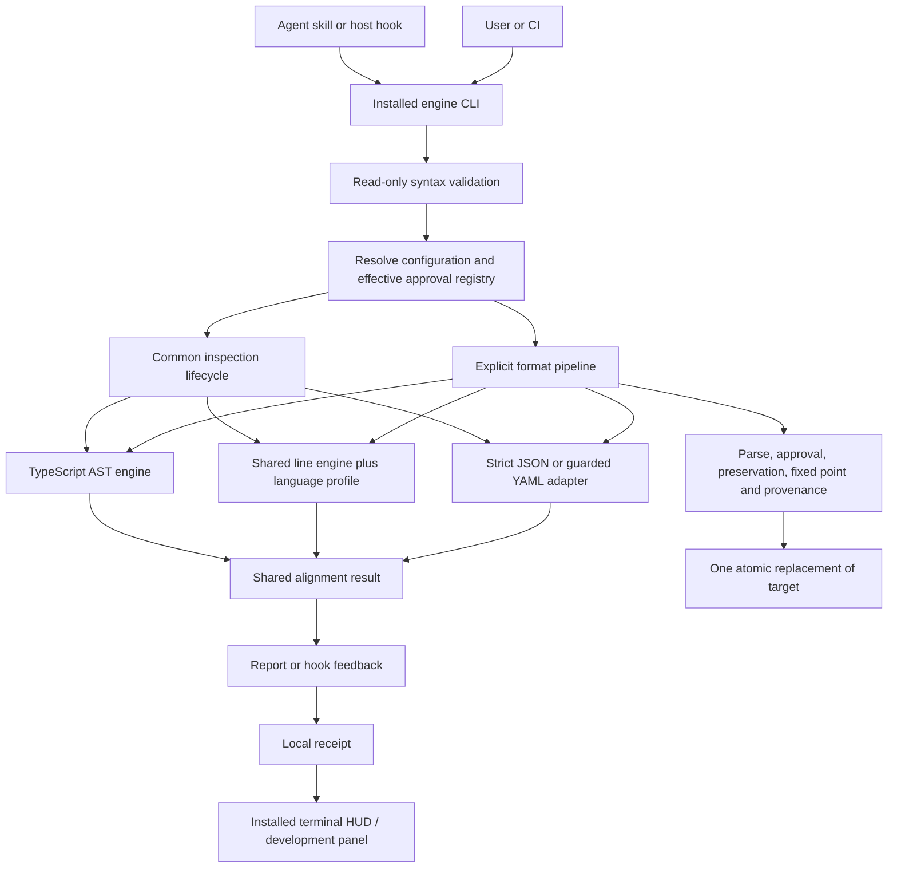

# BoxBox architecture

## Purpose and scope

BoxBox detects consecutive rows that can be represented as a table, then aligns their syntax boundaries to the
minimum required widths. Its own rewrite stage preserves content and execution order. Human-approved rule data
controls public formatting; inspection observations never approve a rule.

The public CLI can inspect TypeScript, Python, strict JSON and guarded YAML. Ten code-language development engines
also exist. These are different support claims: parser/detector availability does not grant write authorization.
The default public preset still approves only the existing TypeScript and Python rules; JSON/YAML candidates require
new approval records before Align or Format may write them. Publication is still pending.

## Interface

The product entry is [cli.ts](../../product/engine/cli.ts). Existing commands include `init`, `doctor`, `check`,
`guide`, `align`, `format`, `db init`, `db status`, `run`, `status` and `hook`. Public file commands recognize
TypeScript, Python, JSON and YAML (`.yaml` and `.yml`).

The 0.2.4 source candidate adds pre-authoring guidance and an alignment-only safety gate. Write and Refactor are
host-agent workflows; Align is a deterministic engine operation. All share approval data and Check, while behavior
and performance verification remain separate. See [modes](../user/modes.md) and the
[inspection process](inspection-process.md) for the exact boundary and preview contract.
See [inspection-process.md](inspection-process.md) for exact distinctions between inspection, readiness and verified writes.

Host adapters invoke an installed engine. Host installation/enabling, permission to run hooks, receipt production,
and native acceptance of hook output are distinct observations. Hooks inspect; they do not automatically format files.

Engine TypeScript modules import other engine modules through the engine-root `@/` alias. Root and copied-skill
configurations map that alias to the same source boundary, and Node builds resolve it before emission. The rules-owned
TypeScript layout JSON and three runtime `import.meta.url` file lookups remain relative by design.

## Process

This is an ownership map, not an assertion that every branch executes every stage. Public `check` does not execute
the format pipeline. The format pipeline orchestrates repeated inspection and working-copy writes before commit.

| Module | Responsibility | Canonical source |
| --- | --- | --- |
| CLI orchestration | Arguments, supported language selection, command-specific envelopes | [cli.ts](../../product/engine/cli.ts) |
| Read-only syntax boundary | Per-language valid/invalid/error result before inspection | [syntax-validation.ts](../../product/engine/common/syntax-validation.ts) |
| Public write pipeline | Optional formatter, syntax acceptance, effective approvals, two full cycles, provenance | [format-pipeline.ts](../../product/engine/common/format-pipeline.ts) |
| TypeScript adapter | AST grouping, kind-specific alignment, scanner preservation | [typescript/](../../product/engine/typescript/) |
| Line-engine adapters | Language syntax masking and row decomposition | [common/table-engine.ts](../../product/engine/common/table-engine.ts), `product/engine/<language>/profile.ts` |
| Structured adapters | Strict JSON and guarded YAML scalar-mapping inspection/alignment | [structured/](../../product/engine/structured/) |
| Safety | Parser comparison, token/content preservation, safe replacement | [common/](../../product/engine/common/) |
| Rule selection | Exact keys, layer/scope selection and approval proof | [conventions.ts](../../product/engine/common/conventions.ts), [approval-gate.ts](../../product/engine/common/approval-gate.ts) |
| Data | Surface forms, references and approved preset | [product/rules/](../../product/rules/) |
| Advisory pattern catalog | Nine-family design inventory and rebuildable development SQLite index; never runtime approval | [patterns/catalog.json](../../product/rules/patterns/catalog.json), [pattern-catalog.ts](../../development/tools/pattern-catalog.ts) |
| Distribution | Host templates, launcher and installer | [product/plugin/](../../product/plugin/), [product/installer/](../../product/installer/) |
| HUD | Installed read-only collector, Claude statusLine and Codex tmux companion | [product/hud/](../../product/hud/) |
| Development | Corpus learning, builds, tests, conversation status panel and release evidence | [development/](../../development/) |

## Data and invariants

- Product sources and runtime imports stay within `product/` or declared external dependencies.
- `plugin/` is regenerated from product templates; `dist/` contains generated archives. See [layout.md](layout.md).
- Configuration precedence is Base → Preset → User → Project. Safety cannot be overridden.
- Only the BoxBox alignment stage promises content-preserving edits. An explicitly configured formatter can make
  its own changes before BoxBox; the report distinguishes both.
- Rule approval, example verification and parser success are separate predicates. None substitutes for another.
- Widths are computed per table. Unknown structure is refused or left untouched; statements are not reordered.
- A successful read-only check is not a proof that a write is authorized or safe.
- `check --json` reports syntax separately as `valid`, `invalid` or `error`. `FileResult.parse` remains write-gate
  evidence and is therefore `not-run` during a successful read-only inspection.
- YAML uses the strict 1.2 core schema. Only runs of at least three adjacent, same-parent, same-indent, single-line
  scalar mappings are candidates; directives, document markers, complex keys, flow/sequence forms, anchors, aliases,
  tags, block scalars and multiline or non-scalar values are reported as unsupported.

## Change points

Keep common lifecycle policy in orchestration/safety modules. Keep AST traversal, masking and syntax slots in language
adapters. Keep approved taste and scope in rule data. Do not force different parsers into one implementation merely
to make the files look alike. The useful common interface is the sequence of responsibilities and observable outcomes.
See [change-patterns.md](change-patterns.md) for a repeatable recipe.

## Verification and limits

The current [package.json](../../package.json) `check` script runs product identity, layout, tests, TypeScript and shell syntax checks. Parser-dependent tests require
installed toolchains; a skipped parser test is unverified. Native host behavior needs actual host evidence separately.
The current audit and bounded test runs are recorded in [the review](reviews/2026-10-21-maintainer-docs.md).
