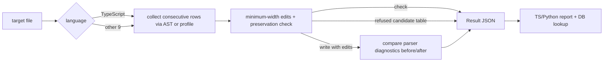

# Current implementation

For a structured entry point and maintenance recipes, start with the [maintainer index](README.md). The [inspection contract](inspection-process.md) distinguishes current check, format and raw engine behavior; the [storage contract](storage.md) records current validation gaps and proposed hardening.

> Snapshot: 2026-10-04 · base commit `8338798` · including the then-uncommitted `development/tools/eval.ts` in the working tree. The 2026-10-07 plugin structure (`plugin/`, lifecycle hooks) is noted where it changes a statement.

> Current-state addendum (2026-10-21): later READINESS1 work added public Check inspection for TypeScript, Python,
> strict JSON and guarded YAML, with a separate top-level syntax result (`valid`, `invalid` or `error`). The
> `FileResult.parse` field remains write-gate evidence and is `not-run` in read-only Check. All four adapters enter
> the common inspection/approval lifecycle, while AST, line-profile and structured-document candidate extraction
> remain separate. JSON/YAML engine support does not authorize writes: the default public preset still contains only
> the two existing TypeScript/Python rules, evaluated through the effective layered registry and exposed as
> `approvalFacts`. YAML uses strict 1.2 core parsing and only aligns runs of at least three adjacent, same-parent,
> same-indent single-line scalar mappings; directives, markers, complex keys, flow/sequence forms, anchors, aliases,
> tags, block scalars and multiline/non-scalar values are unsupported.
>
> READINESS1 also added complete runtime shape validation for convention, example and decision-reference/receipt
> records, a versioned TypeScript
> layout-policy slice, and a nine-family/45-case advisory pattern catalog. Its SQLite index is rebuildable development
> output under `.boxbox/cache/`; runtime selection and approval continue to use canonical records. All 169
> engine-internal module specifiers now use the engine-root `@/` alias. Copied-skill TypeScript/JSON/YAML execution,
> isolated Node bundle resolution, public and installer artifacts, Windows-safe path containment and the final
> repository check passed with 632 passes, five pre-existing parser-toolchain skips and zero failures. Three
> pre-existing non-whitespace alignment refusals in the Kotlin, Rust and Swift profiles remain unchanged. GLM final
> source audit and supplementary closure passed; authenticated native host acceptance remains pending.

This document describes the code that runs today, not the target design. The target state and roadmap follow
[`design.md`](design.md), and the work order and completion verdicts follow [`plan.md`](plan.md).
Only behavior confirmed in the repository's scripts, tests and manifests counts as implemented here.

## 1. Current product

`boxbox` is an agent skill plugin that finds consecutive same-role rows in one file and aligns them into minimum-width
columns. The product and display names are `boxbox` / `BoxBox`, confirmed on 2026-10-16, and
[`package.json`](../../package.json) is `private: true`, version `0.2.1`.

The usable surfaces today are the TypeScript 7 AST tools, a shared line engine for the other 9 languages,
version 1 Result JSON, TypeScript and Python reports, Claude Code observation hooks, corpus verdict and fixture
promotion tools, and an install script for the skill and inspector on Claude Code, ZCode, Codex and Pi.

A public CLI foundation and the config, approval and formatter cores were added. `init`, `doctor` and `check` in `cli.ts`
were verified on a Node-only isolated install. Config is Base → recommended Preset → User → Project, and
schema 1 is interpreted as schema 2 without changing the original. Optional formatter commands are given explicitly per language; absence selects standalone approved alignment.

`boxbox db init` creates the empty `conventions.jsonl`, `examples.jsonl` and `decisions.jsonl` of the user-layer DB
with 0600 file permissions and new user paths with 0700 permissions. `boxbox db status` returns only the
path, existence, non-empty line count and byte size, without record contents.
Both commands use only `XDG_CONFIG_HOME/boxbox` (when absolute) or `~/.config/boxbox`. They never copy the preset or
send data anywhere, and they keep or refuse existing files, symlinks and path components that are not directories.

`common/approval-gate.ts` checks not only a rule's status but also the human approval information, examples and counterexamples,
versions and document hash of the linked decision. It checks path escapes of per-layer document roots and registry files.
`common/format-pipeline.ts` applies optional formatter → parser → approval gate → BoxBox to a working copy, then
runs the whole process again to confirm a byte fixed point. Only a successful result is replaced, once, and dry-run keeps the original.
The public CLI's `guide` returns only verified after-better examples, and `format` calls the pipeline above.
`doctor` exits by whether the environment is runnable and reports `formatConfigured` and the undecided `releaseReady` separately.

These surfaces are not complete yet.

- A closed learning path that loads corpus verdicts into the convention/example/decision DB and feeds GUIDE
- Real host acceptance of hook output end to end, and an integrated LEARN / GUIDE / REVIEW interface
- Running the release plugin (`plugin/`, 2026-10-07) against the published engine: it installs in Claude Code and Codex, and its hooks use a local-engine shim that refuses to run without an explicit `BOXBOX_CLI` (2026-10-16 safety update)

## 2. Module map and execution flow

| Area | Real responsibility | Main files |
|---|---|---|
| Host adapters | discovering the skill and the read-only inspector | [`plugin/`](../../plugin/README.md) (release, Claude Code and Codex), [`agents/`](../../development/agents/readability-inspector.md), [`codex/`](../../development/codex/readability-inspector.toml) (development) |
| Skill contract | work order, per-language commands, rules for human judgment | [`SKILL.md`](../../development/skills/boxbox/SKILL.md), [`references/`](../../product/rules/references/readability-contract.md) |
| TypeScript engine | AST sibling groups, per-kind axes, token gate, TS re-parse | [`typescript/06_align-tables.ts`](../../product/engine/typescript/06_align-tables.ts), [`grid-kinds.ts`](../../product/engine/typescript/grid-kinds.ts) |
| Line engine | masking, row decomposition, consecutive runs, minimum-width alignment | [`common/table-engine.ts`](../../product/engine/common/table-engine.ts), [`common/code-text.ts`](../../product/engine/common/code-text.ts) |
| Language profiles | the small patterns and slots each language allows | [`python/profile.ts`](../../product/engine/python/profile.ts) and each language's `profile.ts` |
| Safety boundary | code/string/comment preservation and external parser diagnostic comparison | [`preservation.ts`](../../product/engine/common/preservation.ts), [`parse-check.ts`](../../product/engine/common/parse-check.ts) |
| Result contract | shared Result JSON schema and summary | [`result-json.ts`](../../product/engine/common/result-json.ts) |
| Report and DB | S1–S4, alarms, exact pattern lookup | [`report.ts`](../../product/engine/report.ts), [`common/conventions.ts`](../../product/engine/common/conventions.ts) |
| Observation hooks | pre-edit baseline, new alarms after the edit, usage records | [`hook.ts`](../../product/engine/hook.ts), [`hooks.json`](../../development/hooks/hooks.json); release: [`lifecycle-hook.ts`](../../product/engine/common/lifecycle-hook.ts), [`plugin/hooks/hooks.json`](../../plugin/hooks/hooks.json) |
| Learning tools | verdicts and regression fixtures from the public corpus | [`development/tools/corpus-signatures.ts`](../../development/tools/corpus-signatures.ts), [`development/tools/corpus-promote.ts`](../../development/tools/corpus-promote.ts) |

The two alignment paths merge into the same Result JSON, but detection and safety checks are separate implementations.



### Shared line engine

Each language's `06_align-tables.ts` is a thin wrapper that passes the profile and arguments to
[`runAlignCli`](../../product/engine/common/align-cli.ts).
The engine builds a mask with the same coordinates as the original and accepts a row only when the slots the profile returns
reassemble exactly into the original gaps. Accepted rows become one run only when they are adjacent and share indentation and axis
signature. Blank lines, comments, different indentation, different axes and lines the profile rejects form boundaries.

Each column's width is the maximum display width in that run. Widths are never shared with other tables, and no trailing
whitespace is created in the last cell. Rows with trailing comments use a separate comment column within the same run.
Two-row runs are reported only as `SUGGEST` pairs, and even with `--min-rows 2` the automatic-fix floor is 3.

Rows whose pattern the profile does not recognize, or that fail lossless reassembly, may drop out of the candidates without
appearing as `REFUSE` in the Result. So `refused=0` does not mean the whole file was classified.
A table becomes `REFUSE` only when the edits of a collected candidate table fail the preservation check.

### TypeScript AST engine

The TypeScript path opens the TypeScript 7 API server through [`load-source-file.ts`](../../product/engine/typescript/load-source-file.ts)
and collects per-kind siblings and axes from [`grid-kinds.ts`](../../product/engine/typescript/grid-kinds.ts).
The file must be a regular file inside the current working folder, and symlinks resolving outside the repository and unsupported
extensions are refused.

Ordinary tables are fixed from 3 rows. The real two-row exception is `declaration-equals` where every row has an `equals`
axis. Import alignment is not a kind of this engine but the responsibility of the separate
[`00_normalize-imports.ts`](../../product/engine/typescript/00_normalize-imports.ts).
Compressed interface members need structural changes, so they are reported as `SUGGEST` and not fixed automatically.

Ordinary edits require identical scanner tokens and comments. Only when declarations with the same call have a long argument
outlier made vertical is adding line breaks allowed, while preserving tokens and comments.
Write checks overlapping edits, the token stream and TS syntactic diagnostics in a temporary working copy in the same directory.
After finishing up to 5 passes and the convergence check, it rechecks the original file's identity and bytes and
renames exactly once. Failed intermediate passes never reach the original.
The real engine is [`typescript/align.ts`](../../product/engine/typescript/align.ts); the existing `06` is a run shim.

## 3. Per-language engines and CLIs

| Language | Engine and representative supported patterns | Parser comparison tool | Entry point |
|---|---|---|---|
| TypeScript | AST kind registry: declarations, type/interface/class/enum, case, assignment, call, guard, object, registration | bundled TypeScript 7 | [`typescript/06_align-tables.ts`](../../product/engine/typescript/06_align-tables.ts) |
| Python | annotation/plain assignment, dataclass field, quoted dict row, bundle, assigned call | `python3` | [`python/06_align-tables.ts`](../../product/engine/python/06_align-tables.ts) |

A line profile is not a language parser. Nested expressions, closures, compound calls, continuations and control statements
not in the support table are mostly excluded from candidates. The real allowed scope is set by each language's
[`profile.ts`](../../product/engine/python/profile.ts) `profile` function and `columnAxes`. Line-engine profiles for
Java, Go, Rust, JavaScript, C, C++, Swift and Kotlin were removed on 2026-10-22 to match the four public languages.

Read-only examples:

```bash
# check mode: prints Result JSON without writing the file
bun product/engine/typescript/06_align-tables.ts \
  --file test/fixtures/table-kinds.ts --json

bun product/engine/python/06_align-tables.ts \
  --file test/fixtures/python/tables.aligned.py --json

# the report currently accepts only TypeScript and Python
bun product/engine/report.ts \
  --file test/fixtures/python/tables.aligned.py --baseline none --json
```

### Result JSON

The envelope in [`result-json.ts`](../../product/engine/common/result-json.ts) is
`{ schemaVersion: 1, tool: "boxbox", results: FileResult[] }`. Each result has `file`, `language`,
`mode`, `summary`, `groups` and `parse`. Group states are `PASS`, `FIXABLE`, `SUGGEST` and
`REFUSE`. `summary.misaligned` is the number of `FIXABLE` groups, not edited rows, and
`summary.edits` is the total edits of those groups (per row in the line engine, per edit span in TypeScript).
The groups and summary of a write result are also pre-fix detection results, so check again for the final alignment state.
TypeScript groups get `context` and `depth` when known. The parse status is `ok`, `changed`, `skipped` or `not-run`,
and it is `not-run` in check mode and for writes without edits.

Exit meanings differ per implementation.

- Shared CLI: 2 without `--file`, 1 for a safe pending edit in check or `parse=changed` in write,
  otherwise 0. It can be 0 with only `REFUSE` and no pending edit.
- TypeScript: 1 for pending edits in check, compressed members, gate/parse/convergence and argument errors.
  A successful write ends with 0 even if the JSON contains the pre-fix `FIXABLE` groups.
- Report: 1 if any safety check fails. Alarms alone do not fail.

## 4. Safety conditions and limits

### What `06_align-tables.ts` guarantees

The line engine preserves the indentation and string/comment byte sequences of changed lines, and allows only horizontal
whitespace changes that do not merge or split tokens. The TypeScript engine compares scanner tokens and comments.
The test harness runs golden, trap, preservation, idempotence and, when parsers exist, diagnostic comparisons.
The grounds are [`preservation.ts`](../../product/engine/common/preservation.ts),
[`token-preservation.ts`](../../product/engine/typescript/token-preservation.ts) and
[`lang-harness.ts`](../../test/lang-harness.ts).

A write's parse `ok` means the output produced **the same normalized diagnostic list** as the original. It is not proof that
the original itself is valid, and not a semantic equivalence check. REL2a turned a missing parser or a failed parser run
in the line engine into an error before writing. `BOXBOX_REQUIRE_PARSERS=0` cannot bypass it.
Spawn errors, timeouts, signals, exceeding the output limit and uninterpretable non-zero exits are never used for diagnostic comparison.
Any non-zero exit of the Python parse wrapper is a failure. The test-only `parserAvailable` keeps the local optional skip and
the CI required-parser contract. The TypeScript parser is a dependency and uses the separate AST path.

The version probe is limited to 5 s, parsing to 60 s by default and at most, and output to 1 MiB per stream.
Failures are passed on as exceptions and non-zero exits for now; normalizing the Result envelope for `--json` failures is follow-up work.
TS and the shared line engine replace atomically after working-copy verification through [`safe-file.ts`](../../product/engine/common/safe-file.ts).
They keep the mode, write only single-link regular files, and refuse when an external edit is detected right before commit.
The lock only coordinates writers using this helper and does not mean a full kernel CAS.
Symlinks in ancestor directories, preserving ACLs and extended attributes, and recovery from power loss were not verified.
Files are checked and written one by one, so several files are not rolled back as one transaction.
The [REL2a verification record](reviews/2026-10-04-parser-fail-closed.md) keeps the real runs before and after the change.

### Boundaries of other write tools

The shared description of token preservation, parsers and Result JSON concerns the `06_align-tables.ts` path.
These tools do not share the same safety gate.

- [`00_normalize-imports.ts`](../../product/engine/typescript/00_normalize-imports.ts) splits and reorders imports
  and switches between one-line and vertical forms.
- [`00_expand-interface-members.ts`](../../product/engine/typescript/00_expand-interface-members.ts) expands
  compressed interface members into physical rows.
- [`07_wrap-conditions.ts`](../../product/engine/typescript/07_wrap-conditions.ts) breaks condition chains across
  lines and may add or change parentheses when needed.
- [`08_function-map.ts`](../../product/engine/typescript/08_function-map.ts) `--scaffold` prints a skeleton with
  items to fill to standard output and writes no file. `--write` applies the alignment of an existing
  function-map comment table to the file.

Each of these tools needs its own narrow tests and follow-up verification, and cannot cite `06`'s safety results instead.

## 5. Report, pattern DB and hooks

[`development/tools/report.ts`](../../product/engine/report.ts) runs the matching aligner on one TypeScript or Python file
and builds S1–S4 and alarms. After `--write` it runs check once more to see idempotence.

- S1: reports the engine's token/string/comment preservation premise. The report does not recompute it independently.
- S2: maps the parser status to `pass`, `fail`, `skipped`, `not-run`.
- S3: checks that the recheck after a write has no pending edits.
- S4: checks that there are no disallowed two-row `FIXABLE` groups.
- A0–A9, A12: review points for pending edits, width, outliers, decomposition failures, pairs, padding and more.

The pattern DB reads the preset
[`conventions.jsonl`](../../product/rules/presets/recommended/conventions.jsonl) and the project's
`.boxbox/conventions.jsonl`. After an exact key match a scope glob applies, and the project layer and more
specific scopes win. A tied status conflict is `conflict`; candidates and old-version keys are `unknown`.

The existing report lookup and the raw per-language aligners do not share the approval policy. The public format path
limits writes by the new approval gate's verification results. Raw development writers are excluded from the public CLI artifact. At survey time, the preset's convention,
example and decision JSONL were empty. On 2026-10-21 the user approved two exact rules and their four examples;
[`development/corpus/verdicts.jsonl`](../../development/corpus/verdicts.jsonl) remains separate from that public preset.

The development [`hooks.json`](../../development/hooks/hooks.json) for the Claude Code plugin registers `SessionStart`, `PreToolUse` and
`PostToolUse`. Targets are `.ts/.mts/.cts/.py` touched by Write/Edit/MultiEdit, excluding `.d.ts` and
`.boxbox/`. pre stores the existing file in `.boxbox/cache/baseline/<tool_use_id>.<ext>`.
post compares the report with the baseline, deletes the baseline and records to `.boxbox/cache/hook-timing.jsonl`.

These hooks only notify. `BOXBOX_HOOKS=off` and internal errors never block the edit. Tests simulate host JSON to check
the baseline and output contract, but whether real Claude Code accepts the output was not measured.
Also [`development/install.sh`](../../development/install.sh) does not install hook settings, so hooks cannot be considered active on a manual install path
that is not a marketplace declaration. The release plugin's hooks (`plugin/hooks/hooks.json` → `lifecycle-hook.ts`) write
records to the host's plugin data folder instead of the project (2026-10-07).

## 6. Corpus learning and evaluation path

In DATA1 on 2026-10-04, 7,759 files of 8 real public repositories were read and 18,613 table observations were loaded.
246 diagnostic signatures fold into 88 exact lookup keys. `corpus-signatures.ts` now stores, per table,
the provenance, commit, file hash and a stable ID in `observations.jsonl`, linked to the aggregate snapshot by
hash. The new `development/tools/corpus-candidates.ts` stores candidates per frequency and source, and before/after examples verified
with the real engine in a working copy, in `.boxbox/cache/corpus/`. It never modifies sources or auto-approves into the preset.
Concrete scope, numbers and limits follow the [real corpus DB status](corpus-data.md).


The current corpus path is connected through these steps.

1. [`corpus-fetch.ts`](../../development/tools/corpus-fetch.ts) fetches the TypeScript/Python public repositories in
   [`development/corpus/manifest.json`](../../development/corpus/manifest.json) and the optional `development/corpus/local.json` into
   `~/.cache/boxbox/corpus/` at pinned commits.
2. [`corpus-signatures.ts`](../../development/tools/corpus-signatures.ts) folds tables into signatures and writes representative locations
   and frequencies to `~/.cache/boxbox/corpus/signatures.json`.
3. [`corpus-triage.ts`](../../development/tools/corpus-triage.ts) sends public representatives to a read-only Codex and leaves proposed
   verdicts in a queue. AI candidates are not human verdicts.
4. [`corpus-judge.ts`](../../development/tools/corpus-judge.ts) appends human verdicts to
   `development/corpus/verdicts.jsonl`. The last record for a signature is the valid one.
5. [`corpus-promote.ts`](../../development/tools/corpus-promote.ts) promotes only `correct` into synthetic fixture/golden/verdict
   and checks alignment-result drift as a gate.

This promotion does not write the preset convention/example/decision JSONL. The approved-example schema and checks are in
[`common/examples.ts`](../../product/engine/common/examples.ts), but there is no execution path yet that automatically loads corpus
verdicts into the approval DB or feeds them to the GUIDE hook. The separate public `guide` command serves verified DB examples. So the learning loop
from verdicts to pattern approval and the automatic-fix policy is not closed.

The then-uncommitted [`development/tools/eval.ts`](../../development/tools/eval.ts) is a research evaluation harness. With the `build`, `run`, `grade`
and `pack` commands it builds TypeScript/Python items and traps, repeats isolated Codex runs, computes accuracy, risk
recall, repeat disagreement and Fleiss kappa, and builds a human judgment pack. At the snapshot it was not tracked by Git,
has no dedicated `test/eval*.test.ts`, and is outside the include of [`tsconfig.json`](../../tsconfig.json).
It needs `eval/corpus`, `eval/instructions` and `~/.codex/auth.json`, so it is treated as a research tool of the
working tree, not a product contract.

### TS function structure observation — OBS1

[`09_observe-shapes.ts`](../../product/engine/typescript/09_observe-shapes.ts) is a development collector that observes
named TypeScript function declarations in an explicit set of files. It is not connected to the integrated public CLI.

```bash
bun product/engine/typescript/09_observe-shapes.ts --root /path/to/project --file src/a.ts --file src/b.ts
```

The scope is given with `--file`, without automatic directory traversal or glob expansion. It is limited to at most 1,000 files
and 16 MiB each for a file's source and the output JSONL. Missing and non-TS files are counted as failures. Only the direct
statements of a function body are recorded in ordered `segments`, and nested declarations are collected as separate units. `parentUnitId` is the nearest
observed function, not the ID of an unsupported container such as an arrow or method itself.
Name, in-scan ID, character range, source hash and structure hash are separate. IDs are not persistent across scans.

Declarations, calls, assignments and exits confirmed from syntax are recorded with stable pattern IDs. Complex control flow is
left as `unknown` and empty statements and the like as `notApplicable`. It never guesses semantic roles such as F1–F4 or reorders code.
Per-shape frequencies, representative locations and classification scope are observational information, not REVIEW violations or permission for automatic fixes.
`completion.unsupported` is the count of arrow and bodiless declaration syntax, not files. It is also not an exhaustive count of all
unsupported syntax such as methods and function expressions. Coverage uses only the direct statements of observed functions as the denominator.

The cache is the project's `.boxbox/cache/shape.jsonl`. Only the latest completed snapshot and one
`shape.previous.jsonl` are kept, and rerunning with the same content does not rotate the baseline.
Partial failures are reported through stdout and the exit code and never overwrite a valid cache.
The current and previous files are separate, so a transaction across both files or recovery after a forced process kill is not guaranteed.
If a writer lock remains, confirm no collector is running and then regenerate that local cache.

The header holds the schema, extractor, real TypeScript parser and profile versions, the input fingerprint, the file scope and the completion state.
The observation stage is `original`. The CLI does not run or auto-detect rules, config, presets or formatters, so
those fingerprints are `unknown`; they can be given explicitly through the program API's `fingerprints` argument.
An unconfirmed fingerprint must never be read as "verified with the same config". Sources and the approval convention/example/decision
DB are not modified. Python function observation, SQLite and automatic promotion of approval candidates are outside the implemented scope.

## 7. Installation and storage locations

[`development/install.sh`](../../development/install.sh) symlinks by default and copies only with `--copy`. Pi is no
exception: its default destination is the current project's `.pi/skills/boxbox`, but the default action is still a symlink.

It places `~/.claude/skills/boxbox` and `~/.claude/agents/readability-inspector.md` for Claude Code,
`~/.agents/skills/boxbox` for ZCode, `~/.codex/skills/boxbox` and
`~/.codex/agents/readability-inspector.toml` for Codex, and `$PWD/.pi/skills/boxbox` for Pi.

A `--copy` install contains the skill folder with a local `tsconfig.json` mapping `@/*` to `engine/*`. It dereferences
the engine and rules links and copies the exact pinned runtime dependencies plus the installed TypeScript platform
package after preflight. Matched directory identities, file hashes and link targets protect refresh and uninstall from
stale markers or user-owned replacements. The install script does not create formatters, the project `.boxbox/`, hook
settings or an integrated CLI executable.

Engine-internal TypeScript imports use `@/`. The rules JSON import in `typescript/layout-policy.ts` stays relative
because its target is outside `product/engine/`; three `new URL(..., import.meta.url)` runtime paths likewise retain
file-relative semantics. Copied-skill checks executed TypeScript, JSON and YAML outside repository ancestry.
The separate `dist/cli` Node package was run outside the repository after npm pack/offline install, with a PATH without Bun.
The public and installer artifact isolation suites also passed after migration. This remains local macOS arm64 evidence;
native Windows execution and installs without the prepared dependency inputs remain separate support evidence.

| Data | Current location |
|---|---|
| Public corpus checkouts and signatures | `~/.cache/boxbox/corpus/` |
| User pattern, example and decision DB | `$XDG_CONFIG_HOME/boxbox/*.jsonl` or `~/.config/boxbox/*.jsonl` |
| Project pattern DB | `<project>/.boxbox/conventions.jsonl` |
| Function structure evidence | `<project>/.boxbox/cache/shape.jsonl` and the previous comparison copy |
| Development hook baseline | `<project>/.boxbox/cache/baseline/` |
| Development hook timing | `<project>/.boxbox/cache/hook-timing.jsonl` |
| Release plugin hook records | `${CLAUDE_PLUGIN_DATA}/hooks/` (host plugin data folder) |
| Preset DB | `product/rules/presets/recommended/*.jsonl` |
| Human corpus verdicts | `development/corpus/verdicts.jsonl` |
| Regression fixtures | `test/fixtures/<language>/` |

The user DB is a different ownership boundary from the package's read-only preset. The following commands never create a project config;
the first creates only missing empty files in `wx` mode. Existing files are kept byte for byte.
Neither command puts DB contents on standard output.

```bash
boxbox db init
boxbox db status
boxbox db status --json
```

`db init --json` returns only the root, whether directories were created, and whether each file was created. `db status --json` returns only
whether the root exists, total bytes, and `path`, `exists`, `rows` and `bytes` per file. Neither output contains
JSONL record contents.

The release preset is maker-owned read-only data, separate from the user DB and research evidence. `bun run build:cli`
outputs, in [`development/tools/build-cli-artifact.ts`](../../development/tools/build-cli-artifact.ts), only records that pass the policy checks of
[`public-preset.ts`](../../development/tools/public-preset.ts). JSONL is reserialized from the validated objects, dropping hidden values of duplicate keys,
and only the document section hashed by an approved decision is extracted to `docs/public/decisions/<id>.md`. Release decision refs also point
at the extract, and sibling sections are not copied. Since the human approval on 2026-10-21, the preset contains two
conventions, four synthetic examples (CC0-1.0 for those examples only) and two decisions. TypeScript resource declarations
and awaited/constructor initializers use a separate kind; Python dotted assignment targets use a separate axis, preventing
inheritance of the narrower approved keys. Internal evidence stays in
`~/.cache/boxbox/corpus/` and is not in the CLI package allowlist. Numbers and privacy limits follow
[`corpus-data.md`](corpus-data.md).
This boundary protects only research data. The current npm package includes the unminified 143,179 B CLI bundle,
so it does not keep the executable code confidential.

## 8. Development verification state

At the snapshot, `bun run check` exited 0 with **403 pass / 5 skip / 0 fail** of 408 tests in 45 files.
`tsc --noEmit` and `bash -n development/install.sh` passed too. The skips are the existing 3 Rust and 2 Kotlin tests.
The items from Sol's read-only cross-review of the public preset boundary were fixed, and a narrow re-review found no remaining findings.
A final audit of the whole repository is a separate step. `bun run pack:cli` produced a 35,415 B tarball with 6 files, and
the public artifact integration test ran on a Node isolated install. Earlier Node and empty-npm-cache evidence follows
[`format-integration.md`](reviews/2026-10-04-format-integration.md), and this DB boundary evidence follows
[`public-preset-db-boundary.md`](reviews/2026-10-04-public-preset-db-boundary.md).

The table aligner alone checked 128 TypeScript files under `product/engine/`, `scripts/` and `test/` read-only.
Of 1,027 recognized tables, 127 files had misaligned 0. The existing research file `development/tools/eval.ts` had 37 tables and
207 edits left and was not changed in that work. These numbers do not mean whole-code lint, import checks or a check rate for
structures the engine does not recognize.

Read-only fixture measurements show the current CLI semantics.

- TypeScript check: 10 groups, 10 misaligned, 52 edits, `parse=not-run`, exit 1
- Aligned Python check: 11 groups, 0 misaligned, 2 suggested, `parse=not-run`, exit 0
- The same Python report: `ok=true`, S2/S3 `not-run`, convention `unknown=9`, records 0
- Go check: even with 11 misaligned, report-only by default so `parse=not-run`, exit 0

So check mode's `ok` or a full test pass must never be read as "every safety check on the target file ran and passed".
Parsers and idempotence are checked on the write path, and writes are refused when the needed parser is missing. Optional
parser verification in tests can be skipped depending on the environment, and patterns outside the profile may not be observed.

Development verification commands:

```bash
bun install
bun run check
```

`check`, the same as CI, is the sequence `bun test`, `tsc --noEmit` and
`bash -n development/install.sh` defined in [`package.json`](../../package.json). The current `tsconfig.json` includes only `skills/**/*.ts` and `test/**/*.ts`,
so research scripts such as the root `development/tools/eval.ts` are not in this type check.

The result contract is checked by [`result-json.test.ts`](../../test/result-json.test.ts), the report and DB by
[`report.test.ts`](../../test/report.test.ts) and [`conventions.test.ts`](../../test/conventions.test.ts),
and hooks and install by [`hook.test.ts`](../../test/hook.test.ts) and
[`install-lifecycle.test.ts`](../../test/install-lifecycle.test.ts).
This is unit and CLI verification scope and does not replace host acceptance verification.

The document was compared against sources and its commands measured, but the independent Claude Sonnet 5 review and the final Opus audit
did not run due to the weekly usage limit. Later, at the user's direction, a separate audit was skipped for this session and
not treated as a blocker. It is not treated as passing an audit, and no substitute audit is called. Details are in the [document verification record](reviews/2026-10-04-implementation-docs-review.md).

## 9. Target design and how to read this

The Base → Preset → User → Project layering, LEARN / GUIDE / REVIEW modes,
formatter integration and the policy of FIXing only approved patterns in [`design.md`](design.md) are targets. The current code has
part of that — the Base profile, preset/project exact lookup, the report and corpus tools — but has not connected all of it into execution policy.

When judging current behavior, prefer this document and the running code; when designing future interfaces, use
`design.md` and `plan.md`. In particular, "proven safe", "approved rule" and "installed in the host" are different
claims. Each needs separate evidence: `06`'s gate results, whether the convention lookup actually controls writes, and whether a real host
accepted the wiring.

## Terminal HUD candidate — 0.2.3

The installer opt-in `--hud` deploys a shared read-only collector from `product/hud/`. Claude uses `statusLine`;
Codex uses an explicit tmux companion launcher. Native macOS terminal rendering and configuration-state changes
were measured. Windows/desktop HUD support and independent audit completion are not claimed.
See [the HUD contract](hud.md), [user setup](../user/hud.md) and [verification record](reviews/2026-10-21-terminal-hud.md).
