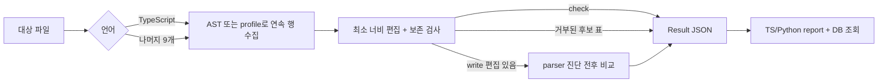

# 실제 구현 현황

> 스냅샷: 2026-10-04 · 기준 커밋 `8338798` · 작업 트리의 미커밋 `scripts/eval.ts` 포함

이 문서는 목표 설계가 아니라 현재 실행되는 코드를 설명한다. 목표 상태와 로드맵은
[`design.md`](design.md), 작업 순서와 완료 판정은 [`plan.md`](plan.md)를 따른다.
여기서는 저장소의 스크립트, 테스트, 매니페스트에서 확인되는 동작만 구현으로 센다.

## 1. 현재 제품

`xxx`는 한 파일에서 같은 역할의 연속 행을 찾아 최소 너비 열로 정렬하는 에이전트 스킬
플러그인이다. 패키지 이름과 표시 이름은 아직 `xxx` / `XXX` 자리표시자이고,
[`package.json`](../package.json)은 `private: true`, 버전 `0.2.0`이다.

현재 사용 가능한 표면은 TypeScript 7 AST 기반 도구, 나머지 9개 언어의 공통 라인 엔진,
버전 1 Result JSON, TypeScript·Python 리포트, Claude Code 관찰 훅, 코퍼스 판정·fixture
승격 도구, Claude Code/ZCode/Codex/Pi용 skill·inspector 설치 스크립트다.

공개용 CLI 기반과 설정·승인·formatter 코어를 추가했다. `cli.ts`의 `init`·`doctor`·`check`는
Node 전용 격리 설치본에서 검증했다. 설정은 Base → recommended Preset → User → Project 순서이며,
schema 1은 원본을 고치지 않고 schema 2로 해석한다. formatter 명령은 언어별로 명시한다.

`xxx db init`은 사용자 계층 DB의 빈 `conventions.jsonl`·`examples.jsonl`·`decisions.jsonl`을
0600 파일 권한으로 만들고, 새 사용자 경로는 0700 권한으로 만든다. `xxx db status`는 레코드 내용 없이
경로·존재 여부·비어 있지 않은 행 수·바이트 크기만 반환한다.
두 명령은 `XDG_CONFIG_HOME/xxx`(절대 경로인 경우) 또는 `~/.config/xxx`만 사용한다. preset을
복사하거나 외부로 데이터를 보내지 않으며, 기존 파일·symlink·디렉터리가 아닌 경로 구성 요소는
각각 보존하거나 거부한다.

`common/approval-gate.ts`는 규칙의 상태뿐 아니라 연결된 Decision의 사람 승인 정보, 예문·반례,
버전과 문서 해시를 검증한다. 층별 문서 root와 registry 파일의 경로 탈출을 검사한다.
`common/format-pipeline.ts`는 formatter → parser → 승인 gate → XXX를 작업본에 적용한 뒤
전체 과정을 다시 실행해 byte 고정점을 확인한다. 성공한 결과만 한 번 교체하며 dry-run은 원본을 보존한다.
공개 CLI의 `guide`는 검증된 after-better 예문만 반환하고, `format`은 위 파이프라인을 호출한다.
`doctor`는 환경 실행 가능 여부로 종료하며, `formatConfigured`와 미확정 `releaseReady`를 별도로 보고한다.

다음 표면은 아직 완료되지 않았다.

- 코퍼스 판정을 convention/example/decision DB에 적재하고 GUIDE에 공급하는 닫힌 학습 경로
- `install.sh`를 통한 훅 등록과 Codex/ZCode/Pi용 훅 어댑터
- 실제 호스트의 훅 출력 수용 종단 검증과 LEARN / GUIDE / REVIEW 통합 인터페이스

## 2. 모듈 지도와 실행 흐름

| 영역 | 실제 책임 | 주요 파일 |
|---|---|---|
| 호스트 어댑터 | 스킬·읽기 전용 inspector 발견 | [`.claude-plugin/`](../.claude-plugin/plugin.json), [`agents/`](../agents/readability-inspector.md), [`codex/`](../codex/readability-inspector.toml) |
| 스킬 계약 | 작업 순서, 언어별 명령, 사람이 판단할 규칙 | [`SKILL.md`](../skills/xxx/SKILL.md), [`references/`](../skills/xxx/references/readability-contract.md) |
| TypeScript 엔진 | AST sibling 그룹, kind별 축, token gate, TS 재파싱 | [`typescript/06_align-tables.ts`](../skills/xxx/scripts/typescript/06_align-tables.ts), [`grid-kinds.ts`](../skills/xxx/scripts/typescript/grid-kinds.ts) |
| 라인 엔진 | 마스킹, 행 분해, 연속 run, 최소 너비 정렬 | [`common/table-engine.ts`](../skills/xxx/scripts/common/table-engine.ts), [`common/code-text.ts`](../skills/xxx/scripts/common/code-text.ts) |
| 언어 profile | 각 언어에서 허용하는 작은 문형과 슬롯 정의 | [`python/profile.ts`](../skills/xxx/scripts/python/profile.ts) 등 각 언어 `profile.ts` |
| 안전 경계 | 코드/문자열/주석 보존과 외부 parser 진단 비교 | [`preservation.ts`](../skills/xxx/scripts/common/preservation.ts), [`parse-check.ts`](../skills/xxx/scripts/common/parse-check.ts) |
| 결과 계약 | 공통 Result JSON schema와 요약 | [`result-json.ts`](../skills/xxx/scripts/common/result-json.ts) |
| 리포트·DB | S1–S4, 알람, 패턴 exact lookup | [`report.ts`](../skills/xxx/scripts/report.ts), [`common/conventions.ts`](../skills/xxx/scripts/common/conventions.ts) |
| 관찰 훅 | 편집 전 baseline, 편집 후 새 알람, 사용량 기록 | [`hook.ts`](../skills/xxx/scripts/hook.ts), [`hooks.json`](../hooks/hooks.json) |
| 학습 도구 | 공개 코퍼스에서 판정과 회귀 fixture 생성 | [`scripts/corpus-signatures.ts`](../scripts/corpus-signatures.ts), [`scripts/corpus-promote.ts`](../scripts/corpus-promote.ts) |

두 정렬 경로는 같은 Result JSON으로 합쳐지지만, 탐지와 안전 검사는 별도 구현이다.



### 공통 라인 엔진

각 언어의 `06_align-tables.ts`는 profile과 인자를
[`runAlignCli`](../skills/xxx/scripts/common/align-cli.ts)에 넘기는 얇은 래퍼다.
엔진은 원본과 같은 좌표의 mask를 만들고, profile이 반환한 슬롯을 원래 gap으로 정확히
재조립할 수 있을 때만 행을 수용한다. 수용된 행은 인접하고 들여쓰기와 축 서명이 같아야
하나의 run이 된다. 빈 줄, 주석, 다른 들여쓰기, 다른 축, profile이 받지 않는 줄은 경계를 만든다.

각 열 너비는 그 run의 표시 폭 최댓값이다. 다른 표와 너비를 공유하지 않으며 마지막 셀에는
trailing whitespace를 만들지 않는다. 뒤쪽 주석이 있는 행은 같은 run 안에서 별도 주석 열을 쓴다.
2행 run은 `SUGGEST` pair로만 보고하고, `--min-rows 2`를 줘도 자동 수정 하한은 3이다.

profile이 문형을 알아보지 못하거나 손실 없는 재조립에 실패한 행은 Result의 `REFUSE`로
나타나지 않고 후보에서 빠질 수 있다. 따라서 `refused=0`은 파일 전체를 분류했다는 뜻이 아니다.
수집된 후보 표의 편집이 보존 검사를 실패했을 때에만 그 표가 `REFUSE`가 된다.

### TypeScript AST 엔진

TypeScript 경로는 [`load-source-file.ts`](../skills/xxx/scripts/typescript/load-source-file.ts)로
TypeScript 7 API server를 열고, [`grid-kinds.ts`](../skills/xxx/scripts/typescript/grid-kinds.ts)의
kind별 sibling과 축을 수집한다. 정규 파일이어야 하고 경로가 현재 작업 폴더 안에 있어야 하며,
저장소 밖으로 해석되는 symlink와 지원하지 않는 확장자는 거절한다.

일반 표는 3행부터 수정한다. 실제 2행 예외는 모든 행에 `equals` 축이 있는
`declaration-equals`다. import 정렬은 이 엔진 kind가 아니라 별도
[`00_normalize-imports.ts`](../skills/xxx/scripts/typescript/00_normalize-imports.ts)의 책임이다.
compressed interface member는 구조 변경이 필요해 `SUGGEST`로 보고하고 자동 수정하지 않는다.

일반 편집은 scanner token과 주석이 같아야 한다. 같은 call을 가진 declaration에서 긴 인자
이상값을 세로형으로 만드는 경우에만 token·주석을 보존하면서 줄바꿈 추가를 허용한다.
write는 같은 디렉터리의 임시 작업본에서 겹치는 edit·token stream과 TS syntactic diagnostics를
검사한다. 최대 5 pass와 수렴 검증을 모두 마친 뒤 최초 파일의 identity·bytes를 재확인하고
한 번만 rename한다. 실패한 중간 pass는 원본에 반영되지 않는다.
실제 엔진은 [`typescript/align.ts`](../skills/xxx/scripts/typescript/align.ts), 기존 `06`은 실행 shim이다.

## 3. 언어별 엔진과 CLI

| 언어 | 엔진·대표 지원 문형 | parser 비교 도구 | 진입점 |
|---|---|---|---|
| TypeScript | AST kind registry: 선언, type/interface/class/enum, case, assignment, call, guard, object, registration | 번들 TypeScript 7 | [`typescript/06_align-tables.ts`](../skills/xxx/scripts/typescript/06_align-tables.ts) |
| Python | annotation/plain assignment, dataclass field, quoted dict row, bundle, assigned call | `python3` | [`python/06_align-tables.ts`](../skills/xxx/scripts/python/06_align-tables.ts) |
| Java | field·상수·enum·중괄호 초기화 행 | `javac` | [`java/06_align-tables.ts`](../skills/xxx/scripts/java/06_align-tables.ts) |
| Go | 선언·field·map 등; 기본 report-only | `gofmt` | [`go/06_align-tables.ts`](../skills/xxx/scripts/go/06_align-tables.ts) |
| Rust | let/const/field/variant 등 profile 문형 | `rustfmt` | [`rust/06_align-tables.ts`](../skills/xxx/scripts/rust/06_align-tables.ts) |
| JavaScript | 선언·object 등 profile 문형 | `node --check` | [`javascript/06_align-tables.ts`](../skills/xxx/scripts/javascript/06_align-tables.ts) |
| C | 선언·define·initializer 등 profile 문형 | `clang` | [`c/06_align-tables.ts`](../skills/xxx/scripts/c/06_align-tables.ts) |
| C++ | 선언·using·initializer 등 profile 문형 | `clang++` | [`cpp/06_align-tables.ts`](../skills/xxx/scripts/cpp/06_align-tables.ts) |
| Swift | typed/plain `let`·`var`, assignment, quoted dictionary row | `swiftc` | [`swift/06_align-tables.ts`](../skills/xxx/scripts/swift/06_align-tables.ts) |
| Kotlin | typed/plain `val`·`var`, assignment, quoted map row | `kotlinc` | [`kotlin/06_align-tables.ts`](../skills/xxx/scripts/kotlin/06_align-tables.ts) |

라인 profile은 언어 parser가 아니다. 지원 표에 없는 nested expression, closure, 복합 call,
continuation과 제어문은 대체로 후보에서 제외한다. 실제 허용 범위는 각 언어
[`profile.ts`](../skills/xxx/scripts/swift/profile.ts)의 `profile` 함수와 `columnAxes`가 정한다.

읽기 전용 확인 예시는 다음과 같다.

```bash
# check 모드: 파일을 쓰지 않고 Result JSON 출력
bun skills/xxx/scripts/typescript/06_align-tables.ts \
  --file skills/xxx/fixtures/table-kinds.ts --json

bun skills/xxx/scripts/python/06_align-tables.ts \
  --file skills/xxx/fixtures/python/tables.aligned.py --json

# Go는 --enable-go가 없으면 report-only이며 항상 종료 코드 0
bun skills/xxx/scripts/go/06_align-tables.ts \
  --file skills/xxx/fixtures/go/tables.go --json

# 리포트는 현재 TypeScript와 Python만 받는다
bun skills/xxx/scripts/report.ts \
  --file skills/xxx/fixtures/python/tables.aligned.py --baseline none --json
```

### Result JSON

[`result-json.ts`](../skills/xxx/scripts/common/result-json.ts)의 envelope는
`{ schemaVersion: 1, tool: "xxx", results: FileResult[] }`다. 각 결과에는 `file`, `language`,
`mode`, `summary`, `groups`, `parse`가 있다. group state는 `PASS`, `FIXABLE`, `SUGGEST`,
`REFUSE`다. `summary.misaligned`는 편집 행 수가 아니라 `FIXABLE` group 수이고,
`summary.edits`는 해당 group들의 편집 개수 합계다(라인 엔진은 행 단위, TypeScript는 편집 구간 단위).
write 결과의 group·summary도 수정 전 탐지 결과이므로 최종 정렬 상태는 다시 check한다.
TypeScript group에는 알 수 있을 때 `context`와 `depth`가
추가된다. parse status는 `ok`, `changed`, `skipped`, `not-run`이며 check 모드와 edit 없는
write에서는 `not-run`이다.

종료 의미는 구현별로 다르다.

- 공통 CLI: `--file` 없음은 2, check의 안전한 pending edit이나 write의 `parse=changed`는 1,
  그 밖에는 0이다. `REFUSE`만 있고 pending edit이 없으면 0일 수 있다.
- Go: `--enable-go`가 없으면 pending edit과 관계없이 0이며 `--write`도 제거된다.
- TypeScript: check의 pending edit, compressed member, gate·parse·convergence·인자 오류는 1이다.
  성공한 write는 수정 전 `FIXABLE` group을 JSON에 담아도 0으로 끝난다.
- 리포트: 안전 검사 하나라도 fail이면 1이다. 알람만으로는 실패하지 않는다.

## 4. 안전 조건과 한계

### `06_align-tables.ts`가 보장하는 것

라인 엔진은 변경 줄의 들여쓰기와 문자열·주석 byte sequence를 보존하고, token이 합쳐지거나
갈라지지 않는 수평 공백 변경만 허용한다. TypeScript 엔진은 scanner token과 주석을 비교한다.
테스트 harness는 golden, trap, 보존, 멱등과 parser가 있을 때의 진단 비교를 수행한다.
근거는 [`preservation.ts`](../skills/xxx/scripts/common/preservation.ts),
[`token-preservation.ts`](../skills/xxx/scripts/typescript/token-preservation.ts),
[`lang-harness.ts`](../test/lang-harness.ts)다.

write의 parse `ok`는 출력이 원본과 **같은 정규화 진단 목록**을 냈다는 뜻이다. 원본 자체가
유효하다는 증명이 아니며 semantic equivalence 검사도 아니다. REL2a에서 라인 엔진의 파서 부재·
실행 실패는 쓰기 전 오류로 바꿨다. `XXX_REQUIRE_PARSERS=0`으로도 우회할 수 없다.
spawn 오류·timeout·signal·출력 한도 초과·해석 불가능한 비영 종료는 진단 비교에 쓰지 않는다.
Python 파싱 wrapper의 비영 종료는 모두 실패다. 테스트용 `parserAvailable`은 로컬 optional skip과
CI 필수 파서 계약을 유지한다. TypeScript parser는 dependency이며 별도 AST 경로를 사용한다.

버전 probe는 최대 5초, 파싱은 기본·최대 60초, 출력은 각 스트림 1MiB로 제한한다.
실패는 현재 예외와 비영 종료로 전달하며 `--json` 실패의 Result envelope 정규화는 후속 작업이다.
TS와 공통 라인 엔진은 [`safe-file.ts`](../skills/xxx/scripts/common/safe-file.ts)로 작업본 검증 후
원자 교체한다. mode를 보존하고, 단일 링크 정규 파일만 쓰며, commit 직전 외부 편집이 감지되면
거절한다. 잠금은 이 helper를 사용하는 writer끼리 협력하며 완전한 커널 CAS를 뜻하지 않는다.
조상 디렉터리의 symlink, ACL·확장 속성 보존과 전원 장애 복구까지 검증한 것은 아니다.
파일별로 검사한 뒤 쓰므로 여러 파일 전체를 한 트랜잭션으로 되돌리지는 않는다.
[REL2a 검증 기록](reviews/2026-10-04-parser-fail-closed.md)에 변경 전후 실제 실행을 남겼다.

Go는 gofmt와의 고정점이 증명되지 않아 기본 report-only다. `--enable-go --write`는 명시적
opt-in이며, 이 경우에만 공통 CLI의 write와 종료 코드가 살아난다.

### 다른 쓰기 도구의 경계

토큰 보존·parser·Result JSON의 공통 설명은 `06_align-tables.ts` 경로에 관한 것이다.
다음 도구는 같은 안전 게이트를 공유하지 않는다.

- [`00_normalize-imports.ts`](../skills/xxx/scripts/typescript/00_normalize-imports.ts)는 import를
  분리·재배치하고 한 줄/세로형을 바꾼다.
- [`00_expand-interface-members.ts`](../skills/xxx/scripts/typescript/00_expand-interface-members.ts)는
  압축된 interface member를 물리 행으로 펼친다.
- [`07_wrap-conditions.ts`](../skills/xxx/scripts/typescript/07_wrap-conditions.ts)는 조건 chain을
  여러 줄로 만들며 필요한 경우 괄호를 추가하거나 바꿀 수 있다.
- [`08_function-map.ts`](../skills/xxx/scripts/typescript/08_function-map.ts)의 `--scaffold`는
  채워야 할 항목을 포함한 골격을 표준 출력에 내보내며 파일은 쓰지 않는다. `--write`는 기존
  function map 주석 표의 정렬을 파일에 반영한다.

이 도구들은 각각 좁은 테스트와 후속 검증으로 다뤄야 하며, `06`의 안전 결과를 대신 인용할 수 없다.

## 5. 리포트, 패턴 DB와 훅

[`scripts/report.ts`](../skills/xxx/scripts/report.ts)는 TypeScript와 Python 파일 하나에 해당
정렬기를 실행하고 S1–S4와 알람을 만든다. `--write` 뒤에는 check를 한 번 더 실행해 멱등을 본다.

- S1: 엔진의 토큰·문자열·주석 보존 전제를 보고한다. 리포트가 독립 재계산하지 않는다.
- S2: parser 상태를 `pass`, `fail`, `skipped`, `not-run`으로 옮긴다.
- S3: write 뒤 recheck에 pending edit이 없는지 본다.
- S4: 허용되지 않은 2행 `FIXABLE` group이 없는지 본다.
- A0–A9·A12: pending edit, 폭, 이상값, 분해 실패, 쌍, padding 등의 검토 지점이다.

패턴 DB는 preset
[`conventions.jsonl`](../skills/xxx/presets/recommended/conventions.jsonl)과 프로젝트의
`.xxx/conventions.jsonl`을 읽는다. key exact match 뒤 scope glob을 적용하며 프로젝트 층과 더
구체적인 scope가 우선한다. 동률 상태 충돌은 `conflict`, candidate와 구버전 key는 `unknown`이다.

기존 report의 lookup과 raw 언어별 정렬기는 승인 정책을 공유하지 않는다. 공개 format 경로는
새 approval-gate의 검증 결과로 쓰기를 제한한다. raw 개발용 writer는 공개 CLI artifact에서 제외한다. 조사 시점 preset의 convention,
example, decision JSONL과 [`corpus/verdicts.jsonl`](../corpus/verdicts.jsonl)은 모두 0건이다.

Claude Code 플러그인용 [`hooks.json`](../hooks/hooks.json)은 `SessionStart`, `PreToolUse`,
`PostToolUse`를 등록한다. 대상은 Write/Edit/MultiEdit가 만지는 `.ts/.mts/.cts/.py`이고 `.d.ts`와
`.xxx/`는 제외한다. pre는 기존 파일을 `.xxx/cache/baseline/<tool_use_id>.<ext>`에 보관한다.
post는 report와 baseline을 비교하고 baseline을 지운 뒤 `.xxx/cache/hook-timing.jsonl`에 기록한다.

훅은 알림 전용이다. `XXX_HOOKS=off`나 내부 오류는 편집을 막지 않는다. 테스트는 host JSON을
흉내 내 baseline과 출력 계약을 검사하지만, 실제 Claude Code가 출력을 수용하는지는 실측하지 않았다.
또한 [`install.sh`](../install.sh)은 hooks 설정을 설치하지 않으므로 marketplace 선언이 아닌 수동
설치 경로에서 훅이 활성화된다고 볼 수 없다.

## 6. 코퍼스 학습과 평가 경로

2026-10-04 DATA1에서 실제 8개 공개 저장소 7,759파일을 읽고 18,613개 표 관측을 적재했다.
246개 진단 시그니처가 88개 정확 조회 키로 묶인다. `corpus-signatures.ts`는 이제
`observations.jsonl`에 표마다 출처·commit·파일 hash와 안정 ID를 저장하며 집계 snapshot과
hash로 연결한다. 새 `scripts/corpus-candidates.ts`는 빈도·출처별 후보와 작업본에서 실제 엔진으로
검증한 전후 예문을 `.xxx/cache/corpus/`에 저장한다. source를 수정하거나 preset에 자동 승인하지 않는다.
구체적인 범위·수치·제한은 [실제 코퍼스 DB 현황](corpus-data.md)을 따른다.


현재 코퍼스 경로는 다음 단계까지 연결된다.

1. [`corpus/manifest.json`](../corpus/manifest.json)의 TypeScript/Python 공개 저장소와 선택적
   `corpus/local.json`을 [`corpus-fetch.ts`](../scripts/corpus-fetch.ts)가
   `~/.cache/xxx/corpus/`에 고정 commit으로 가져온다.
2. [`corpus-signatures.ts`](../scripts/corpus-signatures.ts)가 표를 시그니처로 접어
   `~/.cache/xxx/corpus/signatures.json`에 대표 위치와 빈도를 쓴다.
3. [`corpus-triage.ts`](../scripts/corpus-triage.ts)가 공개 대표를 읽기 전용 Codex에 보내 판정
   후보를 queue에 남긴다. AI 후보는 사람 verdict가 아니다.
4. [`corpus-judge.ts`](../scripts/corpus-judge.ts)가 사람 verdict를
   `corpus/verdicts.jsonl`에 append한다. 같은 signature의 마지막 레코드가 유효하다.
5. [`corpus-promote.ts`](../scripts/corpus-promote.ts)는 `correct`만 합성 fixture/golden/verdict로
   승격하고 정렬 결과 drift를 gate로 확인한다.

이 승격은 preset convention/example/decision JSONL을 쓰지 않는다. 승인 예문 schema와 검사는
[`common/examples.ts`](../skills/xxx/scripts/common/examples.ts)에 있지만, 코퍼스 판정을 승인 DB에 자동 적재하거나
GUIDE 훅에 공급하는 실행 경로는 아직 없다. 별도 공개 `guide` 명령은 검증된 DB 예문을 제공한다. 따라서 verdict에서 패턴 승인과 자동 수정 정책으로
이어지는 학습 순환은 닫히지 않았다.

미커밋 [`scripts/eval.ts`](../scripts/eval.ts)는 연구용 평가 harness다. `build`, `run`, `grade`,
`pack` 명령으로 TypeScript/Python 항목과 trap을 만들고, 격리한 Codex 실행을 반복하고, 정확도·위험
재현율·반복 불일치·Fleiss kappa를 계산해 사람 판정 pack을 만든다. 현재 Git 추적 대상이 아니고
전용 `test/eval*.test.ts`가 없으며 [`tsconfig.json`](../tsconfig.json)의 include 밖이다.
실행에는 `eval/corpus`, `eval/instructions`, `~/.codex/auth.json`이 필요하므로 제품 계약이 아니라
작업 트리의 연구 도구로 취급한다.

### TS 함수 구조 관측 — OBS1

[`09_observe-shapes.ts`](../skills/xxx/scripts/typescript/09_observe-shapes.ts)는 명시한 파일 집합에서
이름 있는 TypeScript 함수 선언을 관측하는 개발용 수집기다. 통합 공개 CLI에 연결되지는 않았다.

```bash
bun skills/xxx/scripts/typescript/09_observe-shapes.ts --root /path/to/project --file src/a.ts --file src/b.ts
```

디렉터리 자동 순회나 glob 확장 없이 `--file`로 범위를 지정한다. 최대 1,000개 파일,
파일당 원문과 출력 JSONL 각각 16MiB로 제한한다. 누락·비TS 파일은 실패로 집계한다. 함수 본문의 직접 문장만
순서 있는 `segments`에 기록하고, 중첩 선언은 별도 단위로 수집한다. `parentUnitId`는 가장 가까운
관측 대상 함수이며, 화살표·메서드 같은 미지원 컨테이너 자체의 ID를 뜻하지 않는다.
이름·스캔 내 ID·문자 범위·원문 해시·구조 해시를 분리한다. ID는 스캔 간 영구 식별자가 아니다.

구문에서 확인한 선언·호출·대입·탈출은 안정 문형 ID로 기록한다. 복잡한 제어 흐름은 `unknown`,
빈 문장 등은 `notApplicable`로 남긴다. F1–F4 같은 의미상 역할을 추측하거나 코드 순서를 바꾸지 않는다.
모양별 빈도·대표 위치·분류 범위는 관측 정보이며 REVIEW 위반이나 자동 수정 권한이 아니다.
`completion.unsupported`는 화살표와 본문 없는 선언의 구문 수이며 파일 수가 아니다. 메서드·함수
표현식 등 모든 미지원 구문을 망라한 수치도 아니다. coverage는 관측한 함수의 직접 문장만 분모로 삼는다.

캐시는 프로젝트의 `.xxx/cache/shape.jsonl`이다. 완료된 최신 스냅샷과
`shape.previous.jsonl` 하나만 보존하며 같은 내용의 재실행은 기준본을 회전시키지 않는다.
부분 실패는 stdout과 종료 코드로 보고하고 정상 캐시를 덮어쓰지 않는다.
현재·직전 파일은 별개이므로 두 파일을 묶은 트랜잭션이나 프로세스 강제 종료 후 복구까지 보장하지 않는다.
writer 잠금이 남은 경우 실행 중인 수집기가 없는지 확인한 뒤 해당 로컬 캐시를 재생성한다.

헤더에는 schema·추출기·실제 TypeScript 파서·profile 버전, 입력 지문, 파일 범위와 완료 상태를 둔다.
관측 단계는 `original`이다. CLI가 규칙·설정·preset·formatter를 실행하거나 자동 탐지하지 않으므로
해당 지문은 `unknown`이며, 프로그램 API의 `fingerprints` 인자로 명시할 수 있다.
지문 미확인을 “같은 설정으로 검증됨”으로 해석하면 안 된다. 소스와 승인 convention/example/decision
DB는 수정하지 않는다. Python 함수 관측·SQLite·승인 후보 자동 승격은 구현 범위 밖이다.

## 7. 설치와 저장 위치

[`install.sh`](../install.sh)은 기본적으로 symlink하고 `--copy`일 때만 복사한다. Pi도 예외가
아니며 기본 목적지가 현재 프로젝트의 `.pi/skills/xxx`일 뿐 기본 동작은 symlink다.

Claude Code에는 `~/.claude/skills/xxx`와 `~/.claude/agents/readability-inspector.md`, ZCode에는
`~/.agents/skills/xxx`, Codex에는 `~/.codex/skills/xxx`와
`~/.codex/agents/readability-inspector.toml`, Pi에는 `$PWD/.pi/skills/xxx`를 배치한다.

`--copy` 설치에는 스킬 폴더만 들어가므로 배포 엔진은 `tsconfig.json`의 `@/` alias에 의존하지
않고 상대 import를 쓴다. 설치 스크립트는 dependency 설치와 skill/agent 배치만 담당하며 formatter,
프로젝트 `.xxx/`, hook 설정, 통합 CLI executable을 만들지 않는다.

dependency 설치는 원본 저장소에서 수행하며, 복사된 스킬에는 원본 `node_modules`가 포함되지
않는다. 따라서 복사·마켓플레이스 설치만으로 TypeScript 의존성까지 해결됐다고 볼 수 없다.
별도 `dist/cli` Node 패키지는 저장소 밖에서 npm pack/offline install 후 Bun 없는 PATH로 실행했다.
이는 로컬 macOS arm64와 준비된 npm cache의 증거다. 실제 호스트 수용·다른 OS·cache 없는 설치는 남아 있다.

| 데이터 | 현재 위치 |
|---|---|
| 공개 코퍼스 checkout·시그니처 | `~/.cache/xxx/corpus/` |
| 사용자 패턴·예문·결정 DB | `$XDG_CONFIG_HOME/xxx/*.jsonl` 또는 `~/.config/xxx/*.jsonl` |
| 프로젝트 패턴 DB | `<project>/.xxx/conventions.jsonl` |
| 함수 구조 Evidence | `<project>/.xxx/cache/shape.jsonl` 및 직전 비교본 |
| 훅 baseline | `<project>/.xxx/cache/baseline/` |
| 훅 timing | `<project>/.xxx/cache/hook-timing.jsonl` |
| preset DB | `skills/xxx/presets/recommended/*.jsonl` |
| 사람 코퍼스 판정 | `corpus/verdicts.jsonl` |
| 회귀 fixture | `skills/xxx/fixtures/<language>/` |

사용자 DB는 패키지의 읽기 전용 preset과 다른 소유 경계다. 다음 명령은 프로젝트 설정을 만들지
않으며, 첫 명령은 누락된 빈 파일만 `wx` 방식으로 만든다. 이미 있는 파일은 바이트 단위로
보존한다. 두 명령 모두 DB 본문을 표준 출력에 넣지 않는다.

```bash
xxx db init
xxx db status
xxx db status --json
```

`db init --json`은 root와 디렉터리 생성 여부, 각 파일의 생성 여부만 반환한다. `db status --json`은
root의 존재 여부·전체 바이트 수와 파일마다 `path`·`exists`·`rows`·`bytes`만 반환한다. 어느 출력에도
JSONL 레코드 본문은 없다.

배포 preset은 사용자 DB나 연구 Evidence와 다른 제작자 소유의 read-only 데이터다. `bun run build:cli`는
[`scripts/build-cli-artifact.ts`](../scripts/build-cli-artifact.ts)에서 [`public-preset.ts`](../scripts/public-preset.ts)의
정책 검사를 통과한 레코드만 출력한다. JSONL은 검증된 객체에서 다시 직렬화해 중복 키의 숨은 값을 버리고,
승인 Decision이 해시한 문서 절만 `docs/public/decisions/<id>.md`로 추출한다. 배포 Decision ref도 추출본을
가리키며 형제 절은 복사하지 않는다. 현재 preset은 빈 JSONL 세 파일이다. 내부 Evidence는
`~/.cache/xxx/corpus/`에 남고 CLI package allowlist에 없다. 수치와 개인정보 한계는
[`corpus-data.md`](corpus-data.md)를 따른다.
이 경계는 연구 데이터만 보호한다. 현재 npm package는 minify되지 않은 143,179 B CLI bundle을 포함하므로
실행 코드의 기밀성을 제공하지 않는다.

## 8. 개발 검증 상태

최신 `bun run check`는 종료 코드 0, 45개 파일·408개 테스트 중 **403 pass / 5 skip / 0 fail**이다.
`tsc --noEmit`과 `bash -n install.sh`도 통과했다. skip은 기존 Rust 3건·Kotlin 2건이다.
공개 preset 경계의 Sol 읽기 전용 교차검토 항목은 수정됐고 좁은 범위 재검토에서 잔여 지적이 없었다.
전체 저장소 최종 감사는 별도 단계다. `bun run pack:cli`는 35,415 B tarball과 6개 파일을 만들었고,
공개 artifact 통합 테스트는 Node 격리 설치에서 실행했다. 이전 Node·빈 npm 캐시 증거는
[`format-integration.md`](reviews/2026-10-04-format-integration.md), 이번 DB 경계 증거는
[`public-preset-db-boundary.md`](reviews/2026-10-04-public-preset-db-boundary.md)를 따른다.

표 정렬기만으로 `skills/xxx/scripts/`, `scripts/`, `test/` 아래 TypeScript 128개를 읽기 전용 검사했다.
1,027개 인식 표 중 127개 파일은 misaligned 0이었다. 기존 연구 파일 `scripts/eval.ts`에서 37개 표·
207 edits가 남았으며 이번 작업에서는 수정하지 않았다. 이 수치는 코드 전체 lint, import 검사,
엔진이 인식하지 못한 구조의 검사율을 뜻하지 않는다.

읽기 전용 fixture 실측은 현재 CLI 의미를 보여 준다.

- TypeScript check: 10 group, 10 misaligned, 52 edits, `parse=not-run`, 종료 1
- 정렬된 Python check: 11 group, 0 misaligned, 2 suggested, `parse=not-run`, 종료 0
- 같은 Python report: `ok=true`, S2/S3 `not-run`, convention `unknown=9`, records 0
- Go check: 11 misaligned여도 기본 report-only라 `parse=not-run`, 종료 0

그러므로 check 모드의 `ok`나 전체 테스트 통과를 “대상 파일의 모든 안전 검사가 실행되어 통과”로
읽으면 안 된다. parser·멱등은 write 경로에서 검사되며, 필요한 parser가 없으면 쓰기는 거절된다. 테스트의 선택적
parser 검증은 환경에 따라 skip될 수 있고,
profile 바깥 문형은 관측되지 않을 수 있다.

개발 검증 명령은 다음과 같다.

```bash
bun install
bun run check
```

CI와 같은 `check`는 [`package.json`](../package.json)에 정의된 `bun test`, `tsc --noEmit`,
`bash -n install.sh`의 순서다. 현재 `tsconfig.json`은 `skills/**/*.ts`와 `test/**/*.ts`만 포함하므로
루트 `scripts/eval.ts` 같은 연구 스크립트는 이 typecheck에 포함되지 않는다.

결과 계약은 [`result-json.test.ts`](../test/result-json.test.ts), 리포트·DB는
[`report.test.ts`](../test/report.test.ts)와 [`conventions.test.ts`](../test/conventions.test.ts),
훅·설치는 [`hook.test.ts`](../test/hook.test.ts)와
[`install-lifecycle.test.ts`](../test/install-lifecycle.test.ts)가 검사한다.
이는 단위·CLI 검증 범위이며 호스트 수용 검증을 대신하지 않는다.

문서의 소스 대조와 명령 실측은 수행했지만, Claude Sonnet 5 독립 검토와 Opus 최종 감사는
주간 사용량 한도로 실행되지 않았다. 이후 사용자 지시로 이번 세션 별도 감사는 생략하며
진행 blocker로 삼지 않는다. 감사 통과로 간주하거나 대체 감사를 호출하지 않는다. 자세한 결과는 [문서 검증 기록](reviews/2026-10-04-implementation-docs-review.md)에 남긴다.

## 9. 목표 설계와 읽는 법

[`design.md`](design.md)의 Base → Preset → User → Project 계층, LEARN / GUIDE / REVIEW 모드,
formatter 통합, 승인된 pattern만 FIX한다는 정책은 목표다. 현재 코드는 그 일부인 Base profile,
preset/project exact lookup, 리포트, 코퍼스 도구를 갖췄지만 실행 정책으로 모두 연결하지 않았다.

현재 동작을 판단할 때는 이 문서와 실행 코드를 우선하고, 향후 인터페이스를 설계할 때는
`design.md`와 `plan.md`를 사용한다. 특히 “안전 증명”, “승인된 규칙”, “호스트에 설치됨”은 서로
다른 주장이다. 각각 `06`의 gate 결과, convention lookup이 실제 write를 제어하는지, 실제 host가
배선을 수용했는지에 대한 별도 증거가 있어야 한다.
